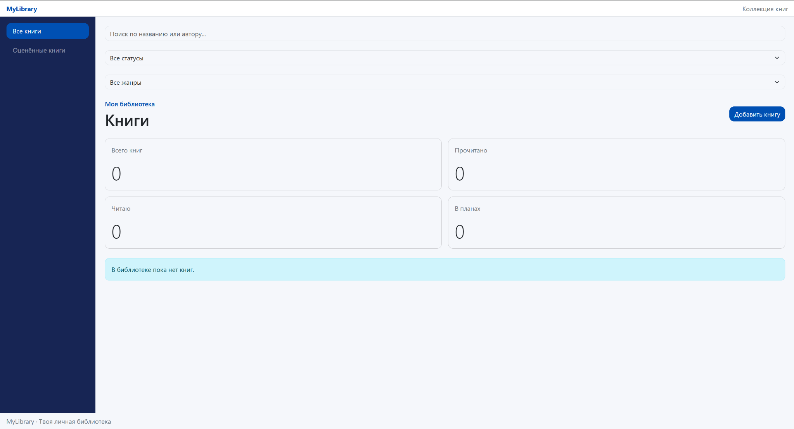
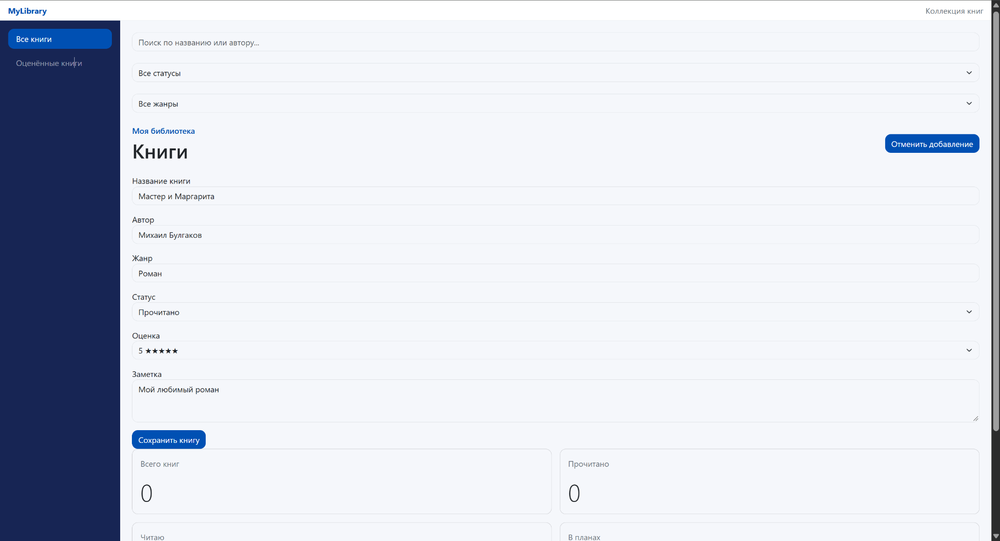
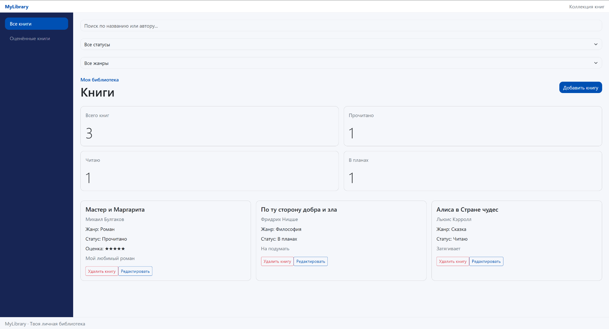
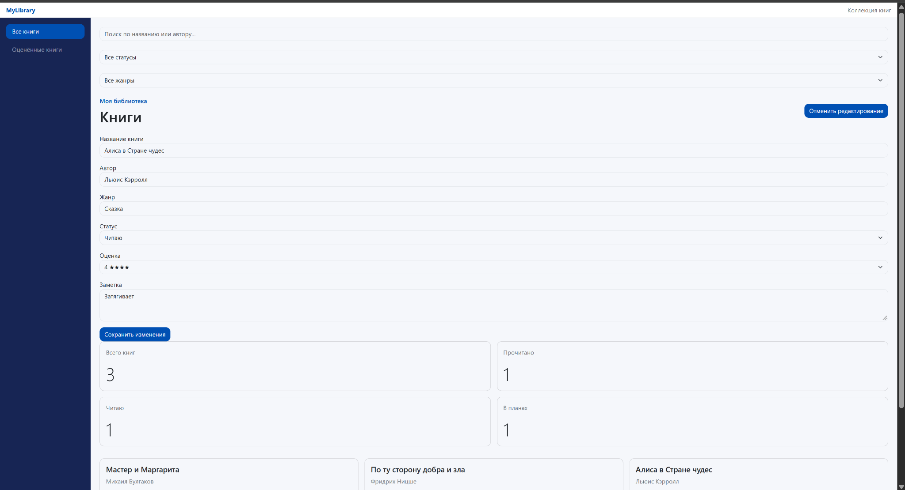
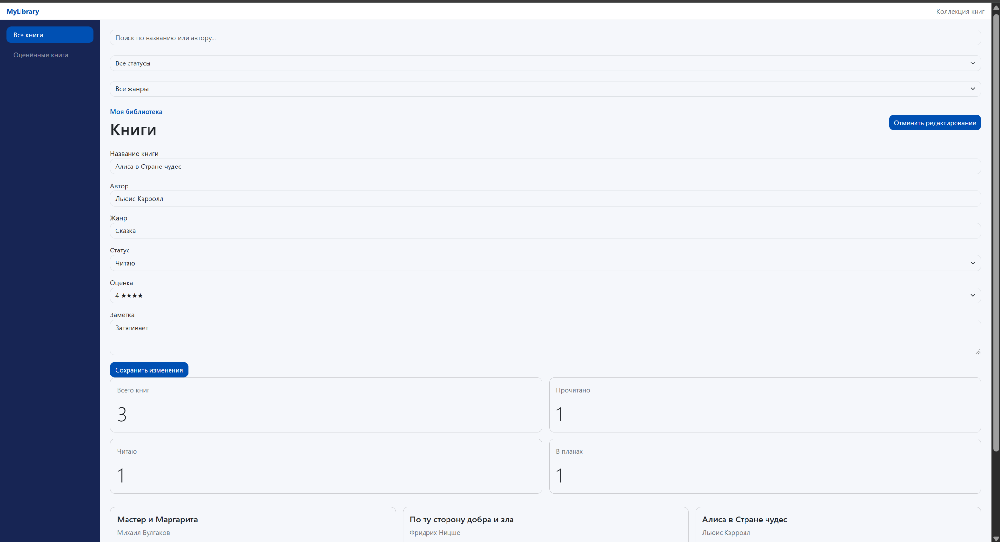
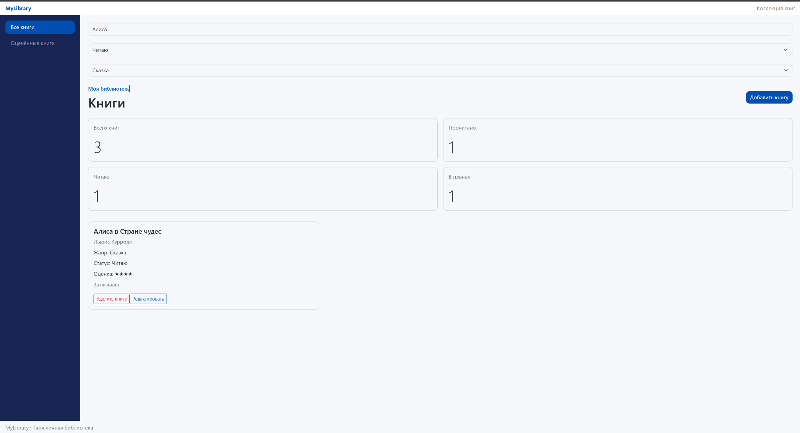
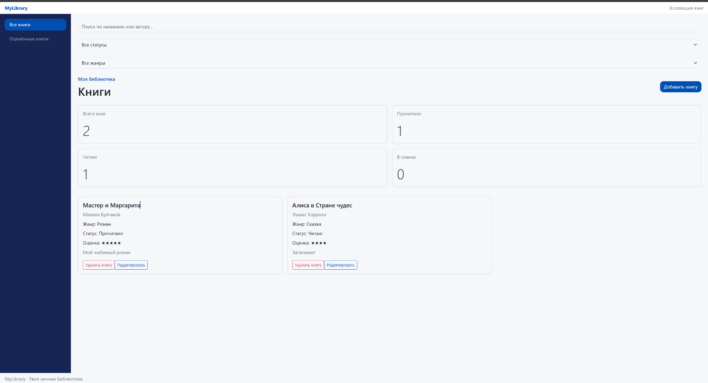
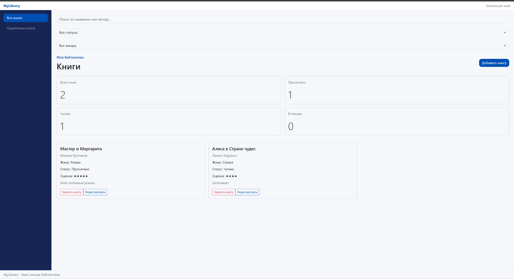

# MyLibrary · домашнее задание 1
Веб-приложение для ведения личной библиотеки

## Возможности
1. Добавление новых книг с указанием автора, названия книги, жанра и статуса по прочтению.
2. Добавить заметку и поставить личную оценку книге.
3. Редактировать информацию о книге.
4. Удалить запись о книге.
5. Поиск книг по названию или автору.
6. Фильтрация по статусу прочтения и жанру.
7. Сохранение данных между сеансами работы в браузере(при помощи localStorage).
8. Просмотр отдельного раздела для просмотра книг, которым пользователь поставил оценку.
    
## Технологии
- React
- TypeScript
- Vite
- Bootstrap
- Sass

## Инструкция по запуску
Требуется установленный Node.js и npm

Склонировать репозиторий и в папке проекта выполнить
```
npm ci
npm run dev
```
После выполнения команд Vite выведет в терминал адрес, по которому можно открыть проект.

## Архитектура
Приложение разделено на логические компоненты:
- App.tsx - общее состояние библиотеки, обработчики добавления, редактирования, удаления, поиск и фильтрация;
- DashboardPage.tsx - отображение статистики, списка книг и управление открытием формы добавления/редактирования книг;
- BookCard.tsx - карточка одной книги;
- BookForm.tsx - форма добавления/редактирования книги;
- Sidebar.tsx - переключение разделов(все книги и оценённые книги) приложения в сайдбаре;
- AppLayout.tsx, Header.tsx, Footer.tsx - общий каркас интерфейса;
- types/book.ts - TypeScript-типы книги и статуса чтения;
- hooks/useLocalStorage.ts - пользовательский хук для хранения состояния в браузере.

## Основные решения
В App.tsx хранится основной массив книг, и дальше в дочерние компоненты передаётся через props.

Основные операции(редактирование, фильтрация, удаление) реализованы при помощи операций с массивом(filter, map и ...). При добавлении, редактировании и удалении мы создаём новый массив, не изменяя старый напрямую.

Используемые хуки:
- useEffect - помогает автоматически сохранять книги, когда их список меняется.
- useLocalStorage - мой пользовательский хук, он загружает сохранённые книги при открытии приложения и сохраняет изменения в браузере.
- useState - хранит данные, которые могут меняться: выбранный раздел, текст поиска, фильтры и значения в форме.

Поиск и фильтры определяют, какие книги показывать на экране. При этом статистика всегда считается по всей библиотеке.

## Демонстрация использования
1. Только запустили приложение, список пустой поддержка пустого состояния:


2. Нажали "Добавить книгу" и появилась форма для добавления книги.


3. Добавили несколько книг


4. Предположим, что мы захотели поставить оценку книге; нажали на "Редактировать" и открылась форма для редактирования
 

5. Попробовали в сайдбаре нажать на "Оценённые книги" и увидели, что у нас теперь две оценённые книги.


6. Пробуем в поиске найти книгу Пушкина(но у нас такой нет), поддержка пустого состояния(при помощи условного рендеринга)


7. При этом просто поиск и фильтрация выдают результат, если есть подходящие варианты


8. Нажали удалить книгу в карточке книги Ницше, пропала книга, статистика обновилась


9. После нажатия F5 состояние осталось тем же самым
